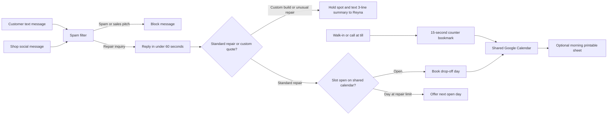

# Gate 4 scoping package for Reyna's Ride Repair

Jorge Bucio prepared this commercial proposal, internal pricing breakdown, and client service agreement for Reyna's Ride Repair, a two-person neighborhood bicycle repair shop. The package defines a fixed-fee booking and schedule setup that answers customer messages in under a minute, blocks spam, and stops Saturday double-bookings without adding a software dashboard for the shop to manage.

## System overview

Reyna's Ride Repair loses repair jobs when texts and social messages sit unanswered while mechanics have grease on their hands. Walk-in bookings at the register also collide with phone and social requests because Reyna, her cousin who works the counter three days a week, and the paper calendar by the till do not share one count of open repair slots.

This setup connects instant text and social replies, a spam filter, one shared Google Calendar with daily repair caps, and a 15-second counter booking bookmark to the shop's existing phone number and social page.

| Metric | Value | Source |
|---|---|---|
| One-time build fee | $650 flat | [01-proposal.md](./gate%204/01-proposal.md), [03-service-agreement.md](./gate%204/03-service-agreement.md) |
| Payment split | $325 at signing, $325 at live handoff | [01-proposal.md](./gate%204/01-proposal.md), [03-service-agreement.md](./gate%204/03-service-agreement.md) |
| Monthly running cost | About $25 paid to service providers | [02-pricing-and-reasoning.md](./gate%204/02-pricing-and-reasoning.md) |
| Scoped builder effort | 12 hours at $55 per hour | [02-pricing-and-reasoning.md](./gate%204/02-pricing-and-reasoning.md) |
| Walk-away floor | $475 minimum | [02-pricing-and-reasoning.md](./gate%204/02-pricing-and-reasoning.md) |
| Expected shop return | $500 to $700 per month from two saved jobs per week | [01-proposal.md](./gate%204/01-proposal.md) |
| Delivery timeline | 5 business days | [03-service-agreement.md](./gate%204/03-service-agreement.md) |
| Post-launch support | 14 calendar days | [03-service-agreement.md](./gate%204/03-service-agreement.md) |



## Subdirectories and system boundaries

**[gate 4/](./gate%204/).** Holds all three Gate 4 commercial and operational documents for the Reyna's Ride Repair engagement.

### Audience boundary

- **Client-facing package.** Send [01-proposal.md](./gate%204/01-proposal.md) and [03-service-agreement.md](./gate%204/03-service-agreement.md) to Reyna for review and signature.
- **Builder-only internal record.** Keep [02-pricing-and-reasoning.md](./gate%204/02-pricing-and-reasoning.md) private. It holds the hour estimate, buffer math, hourly rate choice, $475 walk-away floor, and $500 Phase 1 fallback scope.

### Scope boundary

Section 2 of [03-service-agreement.md](./gate%204/03-service-agreement.md) excludes five items from the $650 build fee:

- Cash register, point-of-sale, invoicing, and credit card payment tools.
- Bicycle parts inventory tracking and supplier ordering.
- Shop website updates and social media post writing.
- Automated price quotes for custom builds or complex repairs.
- Monthly provider fees for texting and automation tools.

## Interface

### Deliverable contracts

| File | Audience | Contract summary |
|---|---|---|
| [gate 4/01-proposal.md](./gate%204/01-proposal.md) | Client | One-page plain-language proposal. States the shop bottlenecks, the four-part setup, the expected return from saving two $60 to $90 tickets a week, the $650 build fee and $25 monthly tool cost, two upfront operational limits, and the Monday kickoff step. |
| [gate 4/02-pricing-and-reasoning.md](./gate%204/02-pricing-and-reasoning.md) | Builder | Internal pricing record. Breaks down 8 base hours plus a 4-hour buffer, justifies the $55 hourly rate inside the $40 to $75 starter range, itemizes the $25 monthly tool cost, and sets the $475 walk-away floor and $500 fallback scope. |
| [gate 4/03-service-agreement.md](./gate%204/03-service-agreement.md) | Client and builder | Signed work agreement. Lists six deliverables, five exclusions, the written change-order rule, the $325 deposit and $325 completion split, the five-day schedule, the 14-day adjustment window, and the signature block. |

### Delivery and payment schedule

| Stage | Timing | Action and milestone |
|---|---|---|
| Signing | Before Day 1 | Client and builder sign [03-service-agreement.md](./gate%204/03-service-agreement.md). Client pays the $325 deposit. |
| Kickoff | Day 1 | Builder runs a 20-minute shop check-in to confirm daily bike limits, shop hours, and phone and social logins. |
| Test build | Days 2 and 3 | Builder sets up and tests instant replies, spam filtering, and Saturday slot caps on a test line without interrupting live shop messages. |
| Live cutover | Day 4 | Builder connects the live shop phone number, social page, shared Google Calendar, and counter bookmark, then runs test bookings with the shop. |
| Handoff | Day 5 | Builder leads a 30-minute counter walkthrough with Reyna and her cousin, hands over the one-page printed cheat sheet, collects the final $325 payment, and starts the 14-day adjustment window. |

### Negotiation fallback

If the client budget cannot reach $650, the builder does not discount the 12-hour scope. Instead, the builder offers a $500 Phase 1 option that drops the social page connection, saves 3 hours of account setup and testing, delivers text message booking plus the shared Saturday calendar, and stays above the $475 walk-away floor.

## Invariants

- **Commercial parity.** Every document that states the full engagement price must match on a $650 flat build fee, a $325 signing deposit, a $325 completion payment, and about $25 per month in provider costs.
- **Hour and rate math.** Base effort totals 8.0 hours across four tasks, split into 3.5 hours to build, 1.5 hours to test, 2.0 hours to connect live accounts and the counter device, and 1.0 hour for counter training and the printed sheet. Adding half again adds 4.0 hours for 12.0 total hours. Twelve hours at $55 per hour equals $660, which rounds to $650.
- **Floor isolation.** Keep the $475 walk-away floor and negotiation notes inside [02-pricing-and-reasoning.md](./gate%204/02-pricing-and-reasoning.md). Never place them in client-facing files.
- **Operational rules.** Customer texts and social messages receive a reply in under 60 seconds. Counter staff log walk-in bookings in 15 seconds through the counter bookmark because the calendar cannot read paper notes. Custom builds and unusual repairs never receive an automated quote; the system holds a spot and texts Reyna a three-line summary to price herself.
- **Written change orders.** Any work outside Section 1 of [03-service-agreement.md](./gate%204/03-service-agreement.md) requires written agreement on scope and price before work starts.

## Side effects

- **Repository state.** None. This repository stores static Markdown files and runs no code, builds, or network calls.
- **Shop systems during execution.** Days 2 and 3 run on an isolated test line so live shop messages continue undisturbed. Day 4 connects one live shop text number, one shop social page, one shared Google Calendar at $0 per month, a message sorting and spam tier under $1 per month, a starter automation and text plan at $20 to $25 per month billed by the providers to the shop, and one browser bookmark on the counter device.

## Verification

Run this check from the repository root to verify that every linked file exists, commercial figures match across documents, and internal floor notes stay out of client-facing files:

```bash
python3 -c '
import pathlib, re, urllib.parse

root = pathlib.Path(".")
readme = (root / "README.md").read_text(encoding="utf-8")
for target in re.findall(r"\]\((\./[^)]+)\)", readme):
    path = root / urllib.parse.unquote(target)
    assert path.exists(), f"Missing linked path: {path}"

proposal = (root / "gate 4/01-proposal.md").read_text(encoding="utf-8")
pricing = (root / "gate 4/02-pricing-and-reasoning.md").read_text(encoding="utf-8")
agreement = (root / "gate 4/03-service-agreement.md").read_text(encoding="utf-8")

for name, doc in [("proposal", proposal), ("pricing", pricing), ("agreement", agreement)]:
    assert "$650" in doc and "$25" in doc, f"Price mismatch in {name}"
for name, doc in [("proposal", proposal), ("agreement", agreement)]:
    assert "$325" in doc, f"Deposit split missing in {name}"
    assert "$475" not in doc and "walk-away" not in doc.lower(), f"Floor leaked into {name}"

assert "$475" in pricing and "12 hours" in pricing and "$55" in pricing
print("All Gate 4 document contracts and commercial invariants verified.")
'
```
